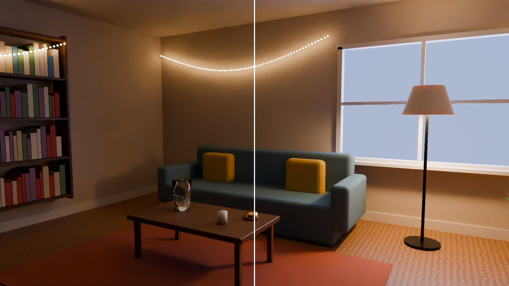
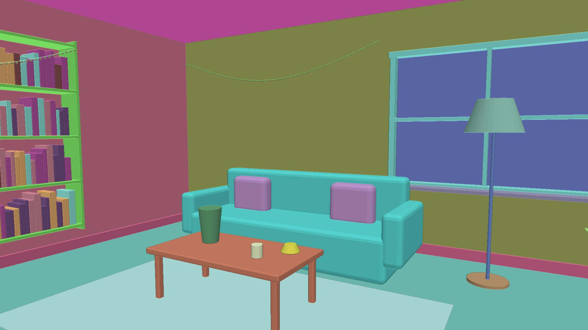
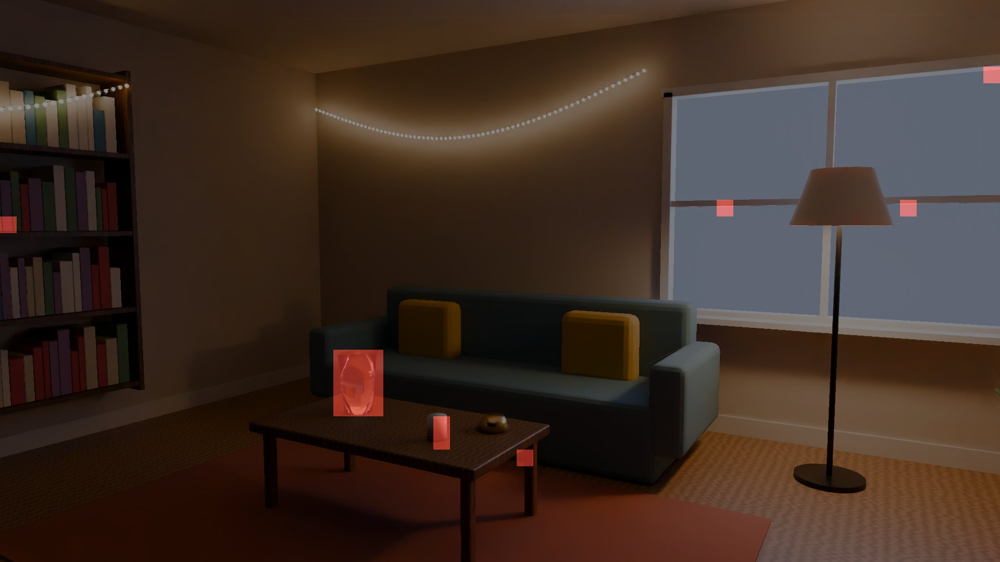

# WarpKernel

**Codec-style frame reuse for Blender Cycles.** Render a few keyframes, predict the frames in between from exact scene
geometry, and path-trace only the pixels that really changed, the way a video codec stores keyframes, motion and a
small correction instead of every frame.



*Left: every frame rendered with Cycles (61 s/frame). Right: WarpKernel (5.5 s/frame). 1920×1080, 2 CPU cores, no GPU.*

> WarpKernel is an independent experiment. It is not part of, or endorsed by, Blender or the Blender Foundation.
> It drives Cycles through Blender's Python API (`bpy`).

## Results

60-frame animations at 1920×1080, Cycles CPU, 8 samples + OpenImageDenoise, on a 2-core cloud VM without a GPU.
Times are wall clock for the whole clip and include everything (keyframes, geometry passes, patches, warping, file I/O).

| Scene | Every frame | WarpKernel | Speed-up | Pixels path-traced | PSNR vs every-frame (noise floor¹) | Flicker² every frame → WarpKernel | Codec temporal ratio³ |
|---|---|---|---|---|---|---|---|
| Cosy room | 3,670 s | 327 s | **11.2×** (10.9× vs median frame time) | 5% | 39.3 dB (41.1) | 0.85 → 0.64 | 3.6× |
| Village square | 2,772 s | 946 s | **2.9×** | 17% | 43.5 dB (47.4) | 1.37 → 1.44 | 4.2× |
| Marble coaster | 2,666 s | 1,407 s | **1.9×** | 38% | 33.9 dB (33.2) | 1.23 → 1.27 | 2.6× |

1. *Noise floor:* the same frame rendered again with a different seed, compared with the every-frame render. A result
   near or above it differs from the reference about as much as a fresh render would.
2. *Flicker:* mean absolute second temporal difference of luminance (×100). Lower is calmer.
3. *Codec temporal ratio:* size of an all-intra H.264 encode ÷ size of a normal inter-frame encode of the every-frame
   clip (CRF 18): how much frame-to-frame redundancy a video codec finds in the same footage.

Per-scene JSON (timings, keyframes, per-frame stats) is in [`results/1080p`](results/1080p).

**In short:** WarpKernel is as fast as the scene is predictable. Calm scenes with mostly diffuse surfaces get about 10×.
Scenes full of mirrors, moving chrome and flashing lights are new information in almost every frame, and gain about 2×.

## How it works

1. **Keyframes.** The first and last frame are rendered normally.
2. **Geometry pass.** Every other frame gets a 1-sample pass with a black material override: world position and object
   ID per pixel. About 0.6 s at 1080p, instead of about 60 s for the full frame.
3. **Warp.** Each pixel's surface point is moved to the keyframe's time with the owning object's exact matrix (static
   objects don't move), projected into the keyframe camera, and its colour is fetched there. Only keyframe samples that
   show the *same object at the same point* are used, so disocclusions are detected exactly. This runs in a compiled
   Numba kernel, the "warp kernel".
4. **Path-trace what changed.** Where both keyframes agree, the pixel is done. Pixels where they disagree (moving shadows,
   view-dependent shading) or that neither keyframe saw are grouped into rectangles and rendered as Cycles border
   renders, with a padded denoiser border and feathered blending.
5. **More keyframes where needed.** If too much of an interval's midpoint would need rendering, the midpoint becomes a
   keyframe and both halves are processed again (like a codec's hierarchical group of pictures).
6. **Patch cache.** Freshly path-traced patches serve as references for the following frames (like P-frames). Whenever
   a patch is rendered anyway, it is compared with what the cache would have predicted. That free measurement gives a
   change rate per screen tile, which decides how long cached pixels may be reused.

Scene knowledge the warp can't see is read from the `.blend` itself: mirror-like materials (always refreshed through the
cache, because two far keyframes can agree by coincidence), animated material values (e.g. flashing bumpers), and
glossy surfaces seen by only one keyframe.

| Geometry pass | Prediction from keyframes, nothing path-traced | Path-traced patches (red) |
|---|---|---|
|  |  |  |

## Limitations

- **Approximate, not unbiased.** Predicted pixels are resampled from keyframes. Errors are small (see table) but can be
  local. Remaining artifacts seen when zooming in at 1080p: a faint lantern outline at the frame edge in the village and
  a small dark notch on a wheel ring in the marble scene.
- **Mirrors and chrome are expensive.** Near-mirror reflections on a moving camera change every frame and are
  re-rendered. Warping reflections along the mirrored viewpoint would be the next step.
- **Per-call overhead.** Every patch is a separate Cycles border render. That costs about 0.02–0.18 s of setup per call
  (the light-tree rebuild dominates in emitter-heavy scenes), which limits how small patches can be.
- **No depth of field or motion blur** in the predicted frames (both are disabled in the test setup).
- **Image metrics are not enough.** Several artifacts (patch seams, ghost outlines, stale reflections) scored fine on
  PSNR/SSIM and were only found by looking at zoomed frames. Check your own results by eye.

## Tried and dropped

- **Half-resolution patches** (low-frequency correction of the prediction). Up to ~35% faster, but visibly wrong in
  reflections.
- **Skipping the light tree for patches.** Lower per-call overhead, but visibly noisier in scenes with many small emitters.
- **Intra-frame adaptive resolution for keyframes** (quarter-res lighting, full-res tiles only for edges, texture,
  mirrors and emitters, with level-matched fading). Keyframes got 24% cheaper, but frames in between needed more
  patching, so the total time was unchanged, and slight artifacts remained. The code is kept in `warpkernel/intra.py`
  (`KF_INTRA=1`).

## Use it on your own animation

```bash
pip install -r requirements.txt
python3 warpkernel/render.py --blend my_scene.blend --out out/my_scene     # -> frames/*.png + my_scene.mp4
python3 warpkernel/check.py  --run out/my_scene                              # reference frames + crops to look at
```

`render.py --blend` takes resolution, frame range, samples and colour management from the file. It warns about what it
can't reproduce (depth of field, motion blur, compositor effects) and switches it off. Objects that change shape
(armatures, shape keys, simulations, animated modifiers) are found automatically and re-rendered every frame.
When a visible object turns more than 45° between two keyframes (`--max-rot`), a keyframe is added in between,
because two keyframes can agree by coincidence (a cube turned 180° looks the same).

`check.py` renders a few reference frames the normal way and writes side-by-side comparisons plus enlarged crops of
the worst areas. Look at them: the method's failure modes are easier to see than to measure.

Try it on the example scene first:

```bash
python3 examples/make_example.py examples/example.blend
python3 warpkernel/render.py --blend examples/example.blend --out out/example
python3 warpkernel/check.py --run out/example
```

On the example (640×360, 48 frames: a rotating cube, a chrome sphere, a wobbling cylinder) this took 65 s instead of
an estimated 140 s, with 46–48 dB PSNR against reference frames.

Working with Claude: [`CLAUDE.md`](CLAUDE.md) holds the workflow and the rules (check by eye, don't trust agreeing
keyframes), so a Claude Code session in this repository can render someone's .blend with it.

## Running the benchmark

Requirements: Python 3.13 with Blender as a Python module (`bpy`, tested with 5.3), see `requirements.txt`.

```bash
pip install -r requirements.txt

# resolution: KF_W=960 (default) or KF_W=1920; output goes to ./out/<W>x<H>/ (or $WARPKERNEL_OUT)
export KF_W=1920

python3 warpkernel/baseline.py interior                 # every frame rendered (reference + timing)
python3 warpkernel/render.py   interior real 0.08 0.3   # WarpKernel: threshold 0.08, split at 30% dirty
python3 warpkernel/evaluate.py interior real            # PSNR / SSIM / flicker vs the reference
python3 warpkernel/codecsize.py interior base           # codec temporal ratio of the reference
python3 warpkernel/compare_video.py interior=real outdoor=real marble=real   # 1920x1080 comparison video
```

Scenes: `interior` (cosy room), `outdoor` (village square), `marble` (marble coaster), built procedurally by the scripts
in [`scenes/`](scenes). `render.py <scene> sim` replays the method offline on an existing baseline (no rendering), which
is handy for tuning.

Main files:

| File | What it does |
|---|---|
| `warpkernel/scenes.py` | loads a test scene, reference lighting, Cycles setup, view layers (Beauty + geometry pass) |
| `warpkernel/warp.py` | reprojection kernel, prediction, dirty rectangles, patch cache, rate model |
| `warpkernel/render.py` | entry point (`--blend` for any file): keyframes, bisection, patch rendering, output |
| `warpkernel/check.py` | reference frames, comparison images and crops for checking by eye |
| `warpkernel/common.py` | render / EXR helpers |
| `warpkernel/intra.py` | the dropped intra-frame experiment |

## Video

A walkthrough of the method and results is on the YouTube channel *Hauke - AI Experiments*.

## Licence

GPL-3.0-or-later. See [LICENSE](LICENSE).
